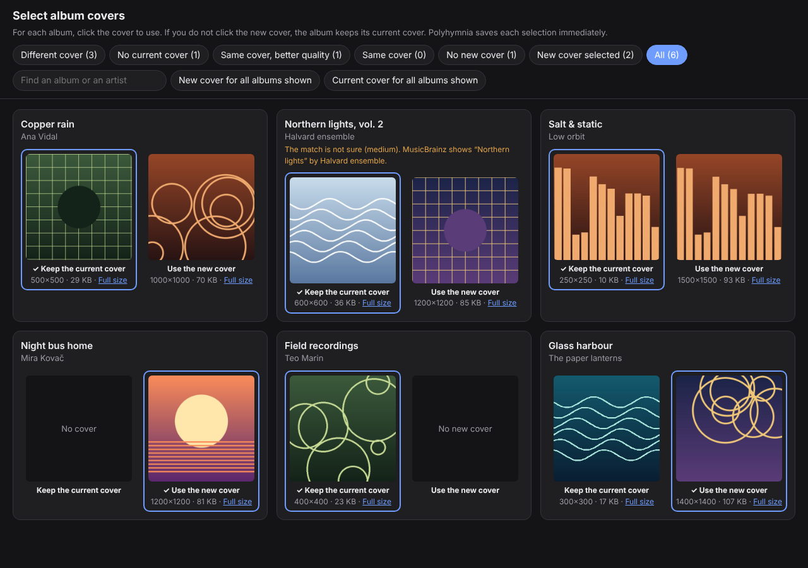

<p align="center"></p>

# Polyhymnia

Polyhymnia examines and corrects the music data in a Jellyfin library.
It corrects album names, track titles, artist names and covers.
The name comes from Polyhymnia, the Muse of sacred song.

This document uses ASD-STE100 Simplified Technical English.

## Safety

- A command that writes data always does a dry run first. A dry run shows the changes and does not write them.
- Before Polyhymnia writes data, it makes a backup. You can restore the initial values from this backup.
- Polyhymnia does not change a value if somebody changed it in Jellyfin after the export.

## Terms

| Term | Definition |
|---|---|
| Dry run | A command without `--commit`. It shows the changes. It does not write them. |
| `--commit` | The option that writes the changes to Jellyfin. |
| Program folder | The folder with the Polyhymnia files from git. |
| Data folder | The folder with your data: exports, edited files, backups and covers. Start all commands in this folder. |
| Export | A JSON file from `export-names`. It contains the names that are in Jellyfin. Do not change this file. |
| Edited file | A copy of an export, with your changes. Its name ends with `_edited.json`. |
| Backup | A JSON file with the initial values. Polyhymnia writes a backup before each change. |
| Artist page | The Jellyfin page for one artist. Jellyfin shows an artist name only if it has an artist page. |
| Library scan | A Jellyfin task that reads the music files again. It also makes the artist pages. |
| Lock | A Jellyfin protection for a name. A library scan cannot change a locked name. |

## Requirements

- A Linux server with Docker and the Docker Compose plugin. To examine this, use `docker compose version`.
- A Jellyfin API key. To make an API key, go to Jellyfin > Dashboard > API Keys, and click **+**.

## Install Polyhymnia

Do these steps one time on each server.

1. Copy the program folder from git:

   ```sh
   git clone https://git.home.arpa/horia/polyhymnia.git
   ```

2. Go to the program folder:

   ```sh
   cd polyhymnia
   ```

3. Make the wrapper executable:

   ```sh
   chmod +x jfa
   ```

4. Make the settings file:

   ```sh
   cp .env.example .env
   ```

5. Open the settings file:

   ```sh
   nano .env
   ```

6. Write your values for `JELLYFIN_URL`, `JELLYFIN_API_KEY` and `MB_CONTACT` (your email address). Save the file.

7. Make the data folder:

   ```sh
   mkdir -p data
   ```

## Start a command

Always start the commands in your data folder. Polyhymnia writes all its files to this folder.

1. Go to the data folder:

   ```sh
   cd data
   ```

2. Start the command with `../jfa`. Example:

   ```sh
   ../jfa check-names jellyfin_names_part0*_edited.json
   ```

The first command builds the Docker image. This takes approximately one minute.
After `git pull`, the next command builds the image again.

### Start a long command in the background

A command in the background continues when you close the session.

1. Put `bg` before the command name:

   ```sh
   ../jfa bg covers-fetch
   ```

2. To see the progress, use:

   ```sh
   docker logs --tail 3 jfa-covers-fetch
   ```

3. When the last line shows the result, remove the stopped container:

   ```sh
   docker rm jfa-covers-fetch
   ```

## Correct the names

Use this procedure for album names, album artists, track titles and track artists.

1. Export the names to JSON files with 250 albums in each file:

   ```sh
   ../jfa export-names --split 250
   ```

2. Make a copy of each file. Add `_edited` to the name of the copy. Example: `jellyfin_names_part01_edited.json`.
3. Edit the copies. Do not change the original files. Do not change the `id` values.
4. Do a dry run for each file. Example:

   ```sh
   ../jfa import-names jellyfin_names_part01.json jellyfin_names_part01_edited.json
   ```

5. Read the list of changes. Make sure that each change is correct.
6. Write the changes. Use the same command and add `--commit`:

   ```sh
   ../jfa import-names jellyfin_names_part01.json jellyfin_names_part01_edited.json --commit
   ```

7. Do steps 4 to 6 for each file.

Polyhymnia also locks each name that it changes.

## Add new albums

Use this procedure after you add one or more albums to your music folder. Polyhymnia changes only the new albums.
An album is new until it is in an edited file (`*_edited.json`) in the data folder.

1. In Jellyfin, start a library scan. Wait until the scan is complete.
2. Go to the data folder.
3. Export the new albums:

   ```sh
   ../jfa export-names --new
   ```

   Result: the list shows the new albums. Polyhymnia writes them to a file with the name `new_albums_<date>-<time>.json`.

4. Make a copy of the file. Add `_edited` to the name of the copy. Example: `new_albums_20261126-0900_edited.json`.
5. Edit the copy. Do not change the `id` values.
6. Do a dry run:

   ```sh
   ../jfa import-names new_albums_20261126-0900.json new_albums_20261126-0900_edited.json
   ```

7. Read the list of changes. Then write the changes. Use the same command and add `--commit`.
8. Lock the names of the new albums:

   ```sh
   ../jfa lock-names new_albums_20261126-0900_edited.json --commit
   ```

9. Download the covers of the new albums. Polyhymnia downloads only the albums that it does not know:

   ```sh
   ../jfa bg covers-fetch
   ```

10. Select and upload the covers. Do steps 2 to 7 of "Select new covers".
11. Examine all names. This command uses all edited files in the data folder:

    ```sh
    ../jfa check-names *_edited.json
    ```

Keep the export and its edited file in the data folder. `--new` and `check-names` use them.

## Examine the names and correct the differences

`check-names` compares Jellyfin with your edited files. Without `--fix`, it does not change data.

1. Examine the names:

   ```sh
   ../jfa check-names jellyfin_names_part0*_edited.json
   ```

2. Read the summary at the top. If all lines show "correct", stop here.
3. Do a dry run of the corrections:

   ```sh
   ../jfa check-names jellyfin_names_part0*_edited.json --fix
   ```

4. Read the section "Plan for --fix". Make sure that each change is correct.
5. Write the corrections:

   ```sh
   ../jfa check-names jellyfin_names_part0*_edited.json --fix --commit
   ```

6. If the report shows names without an artist page, start a library scan in Jellyfin. Then do step 1 again.

Keep the original exports next to the edited files. `check-names` uses them to find the artist names that an edit replaced.

## Lock all names

A library scan can change names that are not locked. Do this procedure to protect all names.

1. Do a dry run:

   ```sh
   ../jfa lock-names jellyfin_names_part0*_edited.json
   ```

2. Lock the names in the background. This takes 30 to 60 minutes for a large library:

   ```sh
   ../jfa bg lock-names jellyfin_names_part0*_edited.json --commit
   ```

CAUTION: Do not use "Refresh metadata" with "Replace all metadata" in Jellyfin. This action reads all music files again. It can change the artists of your albums.

## Select new covers

1. Download the current covers and the new covers in the background:

   ```sh
   ../jfa bg covers-fetch
   ```

2. When the download is complete, start the cover picker:

   ```sh
   ../jfa covers-review
   ```

3. In your browser, open `http://SERVER-IP:8765`.
4. For each album, click the cover to use. Polyhymnia saves each selection immediately.
5. When you have completed the selection, press Ctrl+C in the terminal.
6. Do a dry run:

   ```sh
   ../jfa covers-apply
   ```

7. Upload the selected covers:

   ```sh
   ../jfa covers-apply --commit
   ```

If you do not click the new cover, the album keeps its current cover.

If the new cover is the same incorrect image as the current cover, the MusicBrainz ID in the music files
is for a different release. In this condition, download the covers again with `--search`.
Polyhymnia then ignores the IDs and finds each album by its name. Example:

```sh
../jfa covers-fetch --album "Depeche" --refetch --search
```
The picker shows the current cover and the new cover next to each other (example with demo albums):



## Restore the initial values

Each command that writes data shows the name of its backup file.

1. Do a dry run:

   ```sh
   ../jfa restore backup-20261125-102105.json
   ```

2. Restore the values:

   ```sh
   ../jfa restore backup-20261125-102105.json --commit
   ```

## Update Polyhymnia

1. Go to the program folder.
2. Download the new version:

   ```sh
   git pull
   ```

The next command builds the Docker image again.

## Problems and solutions

| Problem | Cause | Action |
|---|---|---|
| A line starts with "NOT CHANGED". | The value in Jellyfin changed after the export. | Examine the value in Jellyfin. If necessary, make a new export. |
| Jellyfin does not show an artist name on an album. | The name has no artist page. | Start a library scan in Jellyfin. Then use `check-names` again. |
| An artist page has the name of a different artist. | The online search of Jellyfin used an incorrect name. | Use `check-names --fix`. It restores the name and locks it. |
| "Jellyfin did not accept the API key (401)". | The API key in `.env` is not correct. | Write the correct API key in `.env`. |
| "function not implemented" for each command (TrueNAS). | The root shell lost its sudo session. | Close the shell. Start `screen` as your normal user, then use `sudo -i` in `screen`. |
| An album keeps an incorrect cover. The new cover is the same image. | The MusicBrainz ID in the music files is for a different release. | Use `covers-fetch --album "name" --refetch --search`. Then select the cover again. |
| "Do not use jfa in the program folder". | You started `jfa` in the program folder. | Go to your data folder. Start the command again. |

## Other files

| File | Contents |
|---|---|
| `docs/HANDOVER.md` | The state of the project and the rules for the names. Use it to continue the work in a new conversation with an assistant. |
| `tools/editor/` | The tool that edits export files in the style of the library. For the procedure, see `tools/editor/README.md`. |

## ⚠️ Provenance and honesty disclaimer

This project is "vibe-coded". A human operator and Claude, the AI assistant from Anthropic, wrote it together. They changed the code again and again until it operated correctly.

Nobody did a formal review or an audit of the code. The repository has no test suite. During the development, Claude did tests with a simulated Jellyfin server. The human operator used Polyhymnia on one real library with 1,053 albums and 16,479 tracks.

Thus, examine each dry run carefully before you use `--commit`. Many special conditions in the code come from problems in that one library, not from a plan. Use Polyhymnia at your own risk. Issues and pull requests are welcome. This is the purpose of the publication.

**Non-affiliation:** This project is not affiliated with Jellyfin, the MetaBrainz Foundation (MusicBrainz and the Cover Art Archive) or the Internet Archive. These organizations do not endorse it. Polyhymnia uses the free MusicBrainz API and the Cover Art Archive. These services limit the number of requests. They can change or stop their services at any time. Polyhymnia also uses the Jellyfin API, which can change in a new Jellyfin version. These dependencies are the largest operational risk of this project.

**Content note:** Album covers are protected by copyright. Use the downloaded covers only for your own library. You are responsible for the use of the data.

## License

MIT. You can use, change and share this project. For the full text, see the file [LICENSE](LICENSE).
